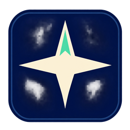
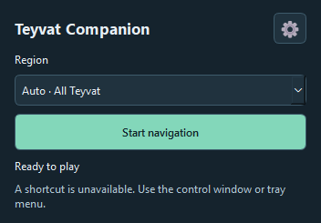

  

<h1 align="center">Teyvat Companion · Windows</h1>

A desktop companion for finding and tracking Genshin Impact chests. Follow a
camera-relative compass, keep progress on your PC, and sync official pins with HoYoLAB.

[Download the Windows preview](../../releases) · [Build and test](docs/BUILD.md) · [Українська інструкція](docs/NAVIGATION_UK.md) · [Privacy](PRIVACY.md)

  

## Get started

1. Download and extract the Windows x64 ZIP. Keep `TeyvatCompanion.exe` and its DLLs together.
2. Start Genshin Impact in windowed or borderless mode. Open Teyvat Companion, select a region if needed, then click **Start navigation**.
3. Return to the game with the minimap visible. If position is unavailable, briefly open the in-game map with **M** and return to gameplay.
4. Follow the compass. The app saves a chest when it recognises its opening. Press **F8** to confirm the current target manually.

Open **Settings → Connect HoYoLAB** to sync. Sign in on the official map within the
app. The app submits queued changes through that page and retains them until the
site confirms them.

| Shortcut | Action |
| --- | --- |
| `F8` | Confirm the current chest |
| `Ctrl+Alt+N` | Skip to the next target |
| `Ctrl+Alt+O` | Toggle the compass |
| `Ctrl+Alt+U` | Undo the last progress change |

The preview shows approximate horizontal distance. Chest detection depends on
the game HUD and a verified position. Underground coverage varies by layer.
Regional selection, language and compass controls are available in Settings.

## Documentation

- [Usage and local data](docs/USAGE.md)
- [Official map integration](docs/INTEGRATIONS.md)
- [Build and test](docs/BUILD.md)
- [Security reporting](SECURITY.md)
- [License](LICENSE) and [third-party notices](THIRD_PARTY_NOTICES.md)

Teyvat Companion is an independent project. Genshin Impact and HoYoLAB are HoYoverse products. The Android edition has its own `teyvat-companion-android` repository.
