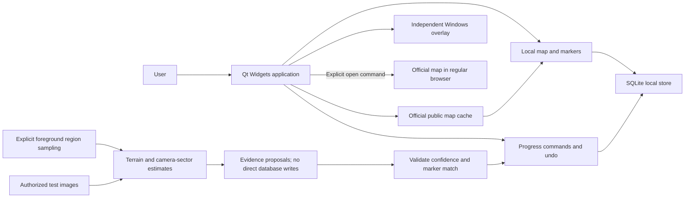

# Architecture and stack decision

Status: official map navigation beta, 0.1.0-beta.3, 2026-11-09. Public official
snapshots/tiles feed a global world-map acquisition and moving local minimap
reference. A separate camera-sector estimate drives the compass/course badge.
Local progress/Undo and per-map/floor identities survive metadata changes.
Standard HUD setup stays in memory; personal opening templates are optional.
Floor-overlay navigation, general opening detection and account writes need work.
See the [current preview](RC3_REPORT.md) and [build guide](BUILD.md).

## Product boundary

One Windows desktop process, a local database, an independent top-level overlay
window, course badge, public first-party map GETs and optional browser links. No game process access or
game hooks. Offline recordings can update local progress through validated
detection and conservative matching, preserving history/undo and review for
ambiguous events. V1 positions are supplied; V2 estimates positions from a
calibrated minimap/reference pair. See [LOCALIZATION.md](LOCALIZATION.md).

## Stack

| Area | Decision | Why / alternative considered |
| --- | --- | --- |
| Domain | C++20 | Native executable and small testable model without a runtime service. |
| Desktop UI | Qt 6 Widgets, Core, Gui, Sql, Concurrent | Native controls, graphics/SQL and bounded background jobs without a browser engine. |
| Map/compass | QGraphicsView/QGraphicsScene for diagnostic maps; a small QPainter QWidget for the compass | Native pan/zoom and a lightweight independent overlay. No WebEngine. |
| Persistence | SQLite through Qt SQL / QSQLITE | One local store; Qt's existing database API avoids a second wrapper library. Test driver presence during startup/packaging. |
| Windows integration | Win32 window styles, RegisterHotKey, Qt native event handling | Independent overlay and system hotkeys; no injected hooks. |
| Build | CMake; official Qt/compiler archives pinned in dependencies.lock.json | Verified Qt 6.11.3 + GCC 13.1.0 pair without rebuilding an SDK. Local setup script replaces the proposed vcpkg bootstrap for this phase. CMake never downloads dependencies. |
| Tests | CTest, core checks and Qt Test for storage/UI | Qt Test already comes with Qt Base. Release-mode checks exercise real SQL, process recovery and widgets. |
| Vision | Static OpenCV 4.12.0 core/imgproc/features2d/calib3d/flann | ORB/similarity geometry with HUD, coverage and ambiguity guards. No nonfree or DNN; original correlation and opening templates retained. |
| Capture | GDI BitBlt of bounded foreground client rectangles | Explicit Start; identity/size/visibility checks, DIB synchronization and no protected-capture fallback. Frames stay in memory; the separate opted-in calibration recorder saves bounded local crops. |
| Official data | Qt Network with Windows Schannel; Qt WebP plugin | Anonymous first-party GET only, complete validated snapshots, stable world frame, per-revision local feature index and no account/credential access. |
| Packaging | Local Windows x64 ZIP with executable, runtime and short instructions | No public repository, CI/CD, installer or update service is requested. |

The application uses official Qt 6.11.3 with matching MinGW GCC 13.1.0. Exact
artifact URLs/hashes are pinned in dependencies.lock.json. The core was also
independently built/tested with the existing GCC 14.2.0. No MSVC build has run.
Dependency setup remains under work/ and does not install globally.

Primary technical references:
[Qt Widgets](https://doc.qt.io/qt-6/qtwidgets-index.html),
[Graphics View](https://doc.qt.io/qt-6/graphicsview.html),
[Qt SQL drivers](https://doc.qt.io/qt-6/sql-driver.html),
[Qt high DPI](https://doc.qt.io/qt-6/highdpi.html),
[Win32 extended styles](https://learn.microsoft.com/en-us/windows/win32/winmsg/extended-window-styles),
[RegisterHotKey](https://learn.microsoft.com/en-us/windows/win32/api/winuser/nf-winuser-registerhotkey),
[Windows screen capture](https://learn.microsoft.com/en-us/windows/apps/develop/media-authoring-processing/screen-capture).
These references support API feasibility, not permission to interact with Genshin.

## Implemented foundation

`include/teyvat/model.hpp` and `src/model.cpp` provide:

- `(source, id)` marker identity; IDs from different datasets cannot collide.
- Required category, region, map layer and coordinate space, with finite X/Y.
- Stable, language-independent names for all five collection statuses; invalid
  serialized status names are rejected instead of silently becoming `unknown`.
- Confirmed-status classification that excludes `possibly_collected` and `unknown`.
- Approximate separation only within the same coordinate space, region and layer.
  Invalid points and overflow return no estimate. The result has map units, not metres.

Coordinate space IDs must include the transform/scale revision. Structural
validation cannot establish authenticity, licence rights, UTF-8 correctness,
provider bounds, reachability or identifier uniqueness in a dataset. Those are
import-boundary checks in Phase 3. No game coordinates or detection results are
fabricated by the core.

## Local storage design

Use a per-user application data directory resolved by Qt, with no administrator
requirement. Exact paths and a documented portable-mode policy belong to Phase 2.
Never place a working database inside the installation directory by default.

| Entity | Identity and important constraints |
| --- | --- |
| Profiles | Stable local profile ID, display name, creation time. |
| MapRegions | Source + region ID, display name, coordinate-space revision. |
| MapLayers | Source + layer ID, region foreign key, surface/underground metadata. |
| MarkerCategories | Source + category ID, localized display labels. |
| Markers | Source + stable marker ID; region, layer, category FKs; finite coordinates; data version; retired flag. |
| UserProgress | Profile + marker composite key; exact status; last-change event/version. |
| Routes | Profile + route ID, mode, region/layer scope, saved name. |
| RoutePoints | Route + sequence key; marker reference or explicit manual point; leg kind. |
| Settings | Profile + setting key, typed value, schema version; allowlisted settings only. |
| DetectionHistory | Immutable change/event ID, profile, marker, before/after status, evidence source, timestamp and optional undo reference. Used for manual changes too. |
| DataVersions | Source + revision; content hash, licence/attribution and coordinate metadata. |

Phase 2 introduced `profiles`, `settings` and `app_state`. Schema v3 adds
`map_regions`, `map_layers`, `marker_categories`, `markers`, `user_progress`,
`detection_history`, `data_versions` and `map_meta`. Schema v4 adds durable detection
receipts and a detection history origin. Routes/route points remain
future design. The store enables foreign keys,
WAL and FULL synchronous mode, parameterizes values and validates settings.
`app_state` stores active profile and geometry. Profile UUIDs are independent of
display names; normalized case-folded names are unique. QLockFile prevents two
application instances from opening the same directory.

Commands change progress and insert their history events in one
transaction. Undo is a new event and must detect intervening changes. Batch edits
are all-or-nothing. Use UTC storage timestamps and localized display times.

Create a consistent backup before each migration using SQLite backup facilities
or another explicitly supported consistent snapshot method, never a blind copy of
a live WAL database. On migration failure, roll back and preserve the original;
never silently reset it. A newer unsupported schema is opened only through an
explicit recovery path, not downgraded. Restore validates a temporary snapshot,
checks exact schema/integrity/references and transactionally replaces rows while
preserving the original source and a pre-restore snapshot.
See [SQLite's backup documentation](https://www.sqlite.org/backup.html).

Source refreshes upsert stable IDs and retire absent markers. Do not cascade-delete
user history/progress on dataset changes. Changed coordinate revisions invalidate
distance comparisons until transforms are explicitly reconciled. Profiles must
remain isolated across progress, settings, routes and history.

## UI and overlay

Build a dark Qt Widgets shell with Dashboard, Map, Overlay, Progress and Settings.
Use translation keys from the start; English and Ukrainian labels must not leak
into serialized values. Provide keyboard navigation, accessible names, readable
contrast and text-based status indicators. Avoid decorative continuous animation.

Map views share immutable marker data and selected-target state; they have
independent viewport transforms. Filter/search does not mutate stored progress.
Manual position requires region, layer and coordinate space; clearing it shows
position unknown. Imported resources display their provenance and bounds.

Overlay is a separate transparent frameless top-level window. Normal mode passes
input through and does not activate. A registered hotkey toggles visibility and a
separate explicit edit mode enables dragging/resizing. Report registration
conflicts and retain a main-window recovery control. Release registrations on
exit. Do not assume `WS_EX_TRANSPARENT` alone proves cross-process click-through;
verify the full layered-window/input behavior on Windows.

Minimal shows a target direction; map-unit estimates require compatible manual
position. Compact shows map/target/route; Expanded adds interactive controls in
edit mode. Store geometry in logical units; restore onto an available screen and
clamp after monitor changes. Test 100/125/150/200% DPI, mixed-monitor DPI,
Alt+Tab, minimize/restore and borderless windows. Exclusive fullscreen is outside
the Alpha support target. Overlay compatibility with HoYoverse remains unverified.

## Routes and progress

Nearest/fast-farming modes rank eligible uncollected markers in one compatible
region/layer. These heuristics are not global optimal-path claims. Approximate
legs must be shown as directions, with a label and distinct rendering. Unknown
terrain, elevation and underground transitions cannot become invented paths.
Allow the user to exclude uncertain markers and manually edit saved routes.

Teleport optimization requires authorized waypoint locations, known layer
transitions and an explicit cost model. If these are unavailable, the mode is
unavailable with a reason. Advance to the next target only after a committed
confirmed status; `possibly_collected` must not advance it. Undo restores eligibility.

Imports use a versioned JSON/CSV contract, declared source and coordinate units,
bounded file/record sizes, finite coordinates, known statuses, duplicate checks,
foreign-key checks and a reviewable conflict summary before a transaction. Exports
must round-trip Unicode/CSV quoting without allowing spreadsheet formula
execution when opened by users. Define and test that escaping contract in Phase 3.

## Background work and resource use

Start with an event-driven UI and no capture loop. Database connections belong
to their owning thread; one serialized writer avoids concurrent progress races.
Long imports and route calculations run off the UI thread with cancellation and
bounded memory. Worker shutdown completes before database/application teardown.

Eco/Balanced/Performance presets will control only implemented work. Hidden or
minimized views stop unnecessary redraws; visibility changes drive updates.
Profile first before adding spatial indices, caches or threading layers. Record
CPU/RAM/GPU and latency on named hardware; the specification's performance targets
are not results. Offline analysis reads bounded local recordings sequentially.
It emits evidence; the store validates/matches it before transactional writes.
Live capture queues and cancellation remain future work.

## Licence decision

MIT is selected for original code. The application dynamically links Qt Core,
Gui, Widgets and Sql. Concurrent run templates use Qt Core's thread pool; Qt Test
and Linguist are build/test-only. Distribution needs an LGPLv3
compliance review, dynamic-library replacement/relinking support, notices and
corresponding-source provisions. MIT licensing of our files does not relicense
Qt. Avoid GPL-only Qt modules unless the project explicitly revises its licence
plan. Review the actual dependency tree and asset licences before packaging.
See [THIRD_PARTY_NOTICES.md](../THIRD_PARTY_NOTICES.md).

## Phase 3 implementation details

MapCanvas uses QGraphicsView with constant-screen-size selectable pins and a
generated coordinate grid or bounded local PNG. No remote tiles are fetched.
MapPage combines layer selection, literal text/category/status filters, batch
progress, archive recovery and region/history views. Marker definitions are
shared; progress/history is profile-scoped. Undo appends new events and validates
the current status/revision. Archive never deletes progress. History is paged.

Qt Concurrent parses imports and performs transactional writes/backups/restore
using a new Store connection owned by the worker thread. Navigation/profile
changes are disabled during work; destruction waits for tasks. Preview tokens
cover dataset, profile, replacement policy and persistent database ID/revision,
checked again under the writer transaction. Restore rotates the database ID.

JSON/CSV boundaries validate Unicode, dimensions, stable identities, statuses and
references. CSV data cells use reversible apostrophe-v1 encoding. Resource/file
references are never followed. PNGs have size/dimension limits and separate
credits. QSaveFile protects exports. Full snapshots use VACUUM INTO; restore
validates read-only input and exact v3 schema, keeps a pre-restore snapshot and
copies rows transactionally rather than swapping a live WAL database.

Current physical SQL definitions are in src/map_store.cpp; the entity table above
is a conceptual overview, including future fields. See docs/INTERCHANGE.md for
the implemented external contract and docs/PHASE3_REPORT.md for verification.

